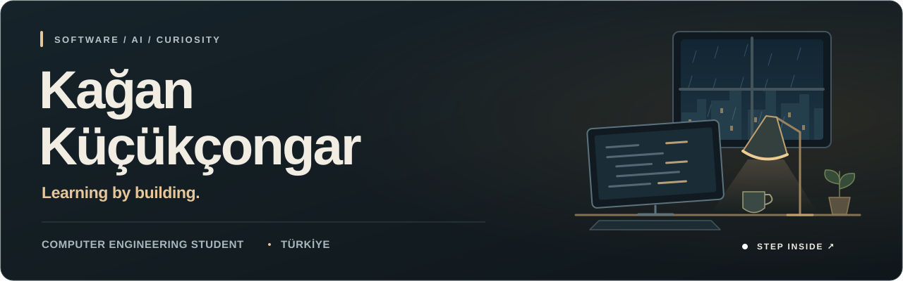
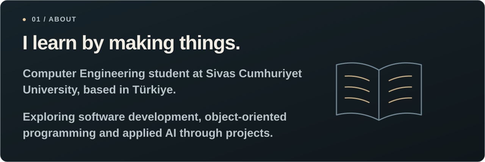
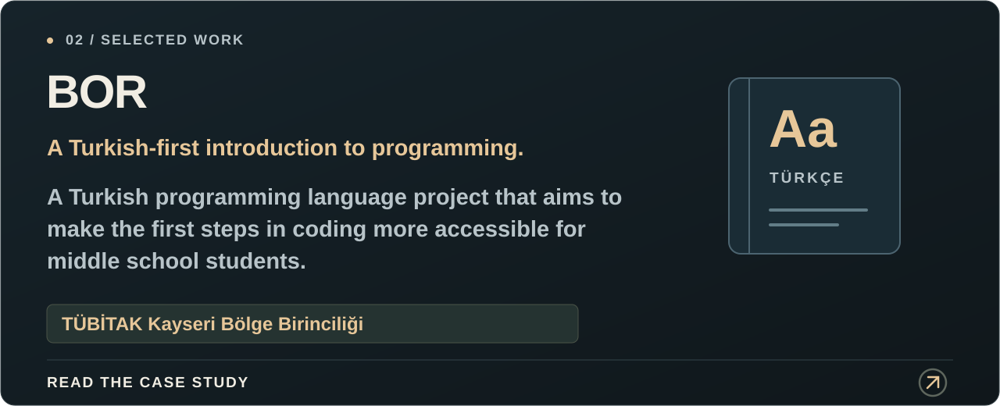
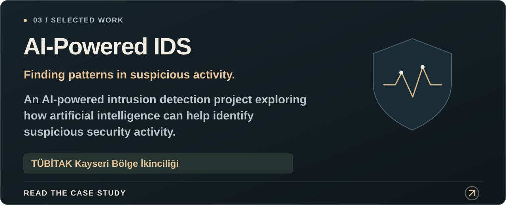
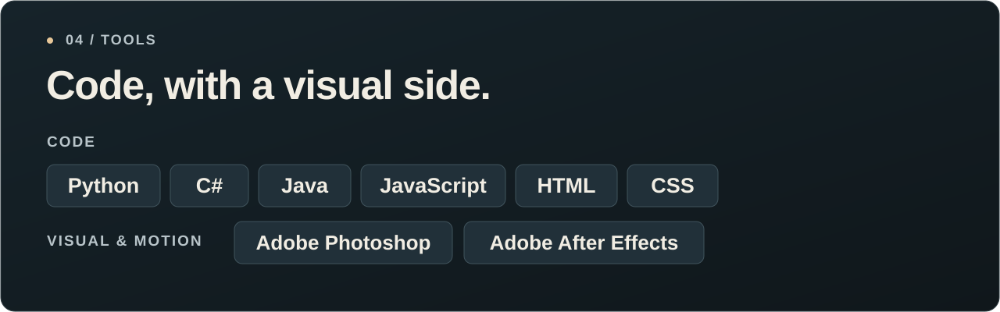
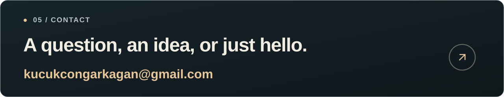
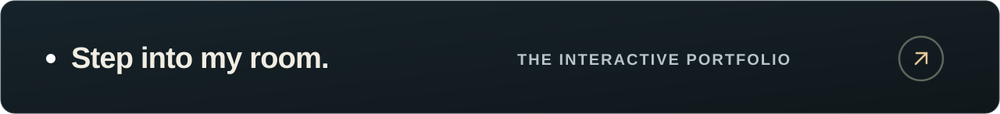

<!-- Local SVG artwork. Each linked panel remains a native link; narrow screens receive a separate readable composition. -->

  <a href="https://kagankucukcongar.github.io/">
  <picture>
    <source media="(max-width: 767px)" srcset="./assets/profile-header-mobile.svg">
    
  </picture>
  </a>

  <picture>
    <source media="(max-width: 767px)" srcset="./assets/profile-about-mobile.svg">
    
  </picture>

  <a href="https://kagankucukcongar.github.io/#proje-bor">
  <picture>
    <source media="(max-width: 767px)" srcset="./assets/profile-bor-mobile.svg">
    
  </picture>
  </a>

  <a href="https://kagankucukcongar.github.io/#proje-ai-ids">
  <picture>
    <source media="(max-width: 767px)" srcset="./assets/profile-ids-mobile.svg">
    
  </picture>
  </a>

  <picture>
    <source media="(max-width: 767px)" srcset="./assets/profile-tools-mobile.svg">
    
  </picture>

  <a href="mailto:kucukcongarkagan@gmail.com">
  <picture>
    <source media="(max-width: 767px)" srcset="./assets/profile-contact-mobile.svg">
    
  </picture>
  </a>

  <a href="https://kagankucukcongar.github.io/">
  <picture>
    <source media="(max-width: 767px)" srcset="./assets/profile-portfolio-mobile.svg">
    
  </picture>
  </a>

Text version &amp; links

## About me

I'm Kağan, a Computer Engineering student based in Türkiye. I turn what I learn into projects, then go back to the fundamentals to understand them better.

My early work explored two questions: how can programming become more approachable, and how can AI help recognize suspicious activity? Today, I'm continuing to learn about software development, object-oriented programming and applied AI.

## Selected projects

### 01 — BOR

**A Turkish-first introduction to programming.**

A Turkish programming language project that aims to make the first steps in coding more accessible for middle school students.

TÜBİTAK Kayseri Bölge Birinciliği

[Explore the case study ↗](https://kagankucukcongar.github.io/#proje-bor)

### 02 — AI-Powered IDS

**Looking for patterns in suspicious activity.**

An AI-powered intrusion detection project exploring how artificial intelligence can help identify suspicious security activity.

TÜBİTAK Kayseri Bölge İkinciliği

[Explore the case study ↗](https://kagankucukcongar.github.io/#proje-ai-ids)

## Tools I work with

**Code**  
`Python` · `C#` · `Java` · `JavaScript` · `HTML` · `CSS`

**Visual & motion design**  
`Adobe Photoshop` · `Adobe After Effects`

---

### Say hello

A question, an idea, or just a hello.

[Email me](mailto:kucukcongarkagan@gmail.com) · [Visit my portfolio](https://kagankucukcongar.github.io/)

